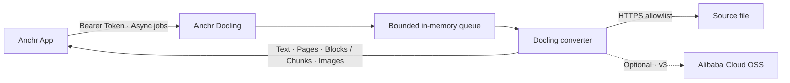

<div align="center">

# Anchr Docling

**The document parsing sidecar for Anchr.**

[](https://www.python.org/)
[](https://github.com/docling-project/docling)
[](https://fastapi.tiangolo.com/)
[](./LICENSE)

</div>

---

Anchr Docling provides document parsing for [Anchr App](https://github.com/ryanmeowy/anchr-app). The app submits a signed HTTPS download URL, and the service runs Docling through a bounded queue to return Markdown, plain text, structured documents, blocks, or chunks. It can also upload embedded document images to a specified Alibaba Cloud OSS directory when needed.

This service does not store knowledge bases, documents, or ingestion tasks. Job status and idempotency records live only in process memory. The app persists the parse identity and resubmits jobs after the sidecar restarts.

## How It Works



- `POST /v1/jobs` submits a job, `GET /v1/jobs/{jobId}` retrieves its result, and `DELETE /v1/jobs/{jobId}` acknowledges a terminal result.
- By default, the service starts one worker with a waiting queue capacity of 8. A full queue returns `429` with `Retry-After: 5`.
- `requestId` is the idempotency key. Repeated requests with the same stable inputs return the original job; the same ID with different stable inputs returns `409`.
- Source files can only be downloaded from a locally configured HTTPS host allowlist. Callers cannot change the allowlist through requests.
- Results are retained for 10 minutes by default, with at most 16 terminal jobs retained. Results are no longer available after acknowledgment, expiration, or a service restart.

## Running the Service

### Prerequisites

- Python `3.11+`
- An environment that can install Docling and its model dependencies
- Access to Docling model download sources, or a prepared local model cache
- An internal token with at least 32 characters
- At least one host allowed for source file downloads

### Install and Start

```bash
git clone https://github.com/ryanmeowy/anchr-docling.git
cd anchr-docling

python -m venv .venv
source .venv/bin/activate
pip install -e .

cp .env.example .env
# Set the token and download allowlist in .env.

uvicorn anchr_docling.main:app --host 127.0.0.1 --port 8091
```

The service validates `ANCHR_DOCLING_API_TOKEN` and `ANCHR_DOCLING_ALLOWED_DOWNLOAD_HOSTS` at startup. In Anchr App, `APP_DOCLING_API_TOKEN` must use the same token, and `APP_DOCLING_BASE_URL` must point to this service.

By default, startup downloads or checks the layout, table, and formula models and initializes the converter. The first startup may take longer if the model cache is not ready. If the deployment environment does not allow access to the model cache or network at startup, disable preloading:

```bash
ANCHR_DOCLING_PRELOAD_MODELS=false
```

OCR models are not preloaded by default. They are initialized only when `ocr: true` is set or OCR fallback is triggered. To prepare the configured OCR engines at startup, set:

```bash
ANCHR_DOCLING_PRELOAD_OCR_MODELS=true
```

### Device

The default device is `cpu`. You can also select `mps`, `cuda`, `xpu`, or `auto`; availability depends on the local PyTorch installation, Docling models, and selected parsing features:

```bash
ANCHR_DOCLING_DEVICE=cpu
```

The project currently pins `transformers` to `>=5.8.1,<5.9.0`. This constraint is applied automatically during installation; no manual dependency adjustment is needed.

## API

All `/v1/*` endpoints require a Bearer Token; `/healthz` does not. Swagger, ReDoc, and OpenAPI are disabled by default. Set `ANCHR_DOCLING_ENABLE_DOCS=true` for local debugging.

### Health Check

```bash
curl http://127.0.0.1:8091/healthz
```

```json
{
  "status": "ok",
  "running": 0,
  "queued": 0,
  "queueCapacity": 8
}
```

This endpoint reports only process and queue status. It does not verify model readiness or connectivity to source file hosts or OSS.

### Submit a Job

```bash
curl -X POST http://127.0.0.1:8091/v1/jobs \
  -H "Authorization: Bearer <internal-token>" \
  -H 'Content-Type: application/json' \
  -d '{
    "requestId": "task_1:item_1:1",
    "contractVersion": 2,
    "sourceRevision": "v1:0123456789abcdef0123456789abcdef0123456789abcdef0123456789abcdef",
    "sourceUrl": "https://anchr.oss-cn-shanghai.aliyuncs.com/document.pdf",
    "fileName": "document.pdf",
    "options": {
      "outputFormat": "chunks",
      "ocr": true,
      "ocrFallback": true,
      "useNativeChunker": true
    }
  }'
```

The host in `sourceUrl` must appear in `ANCHR_DOCLING_ALLOWED_DOWNLOAD_HOSTS`. New jobs return `202 Accepted`; an idempotent request matching an existing job returns `200 OK`.

Top-level fields:

| Field | Required | Description |
| --- | --- | --- |
| `requestId` | Yes | Idempotency ID for a parse attempt, up to 200 characters. The app uses `taskId:itemId:parseAttempt`. |
| `contractVersion` | For new app requests | Supports `1`, `2`, and `3`. Standard parsing currently uses v2; embedded image uploads use v3. |
| `sourceRevision` | For v2 / v3 | Stable source content revision, up to 80 characters. Do not use a signed URL that changes when refreshed. |
| `sourceUrl` | Yes | HTTPS URL of the source file. |
| `fileName` | For v2 / v3 | File name including its extension, used to select the parsing path. |
| `options` | No | Parsing and output options. |
| `oss` | For image uploads | Embedded image upload destination and encrypted STS credentials. |

When `contractVersion` is omitted or set to v1, the idempotency fingerprint includes the entire request, primarily for compatibility with older callers. The v2 and v3 fingerprints exclude the expiring `sourceUrl` and encrypted credentials, so the same attempt can be retried with a refreshed signed URL or STS credentials. Changes to `sourceRevision`, the file name, parsing options, or the stable output destination require a new `requestId`.

Parsing options:

| Field | Default | Description |
| --- | --- | --- |
| `outputFormat` | `markdown` | `markdown`, `html`, `text`, `json`, `blocks`, or `chunks`. |
| `ocr` | `false` | Enables OCR directly; usually needed for image inputs. |
| `ocrFallback` | `false` | Tries the configured OCR engines in order when non-OCR output is classified as garbled text. |
| `tableStructure` | `true` | Enables table structure recognition. |
| `formulaEnrichment` | `false` | Enables Docling formula enrichment. Adds model preparation and parsing time. |
| `validateTextQuality` | `true` | Checks for clearly garbled text; empty results from non-image inputs are treated as failures. |
| `chunkMinTokens` | `400` | Target lower bound for the custom chunker; controls merging in the native chunker. |
| `chunkMaxTokens` | `800` | The custom chunker limits size using estimated character counts; the native chunker splits using estimated token counts. |
| `useNativeChunker` | `false` | Uses Docling `HybridChunker`; otherwise splits by Markdown structure. |
| `includeEmbeddedImages` | `false` | Enables embedded image processing for `markdown`, `blocks`, and `chunks`. |

### Retrieve and Acknowledge Results

```bash
curl http://127.0.0.1:8091/v1/jobs/<jobId> \
  -H "Authorization: Bearer <internal-token>"
```

Job status is `queued`, `running`, `succeeded`, or `failed`. Successful output is in `result`, and failure details are in `error`:

```json
{
  "jobId": "4c54b626-e367-4c92-a351-62d52f68948a",
  "requestId": "task_1:item_1:1",
  "status": "succeeded",
  "createdAt": "2026-07-10T10:00:00Z",
  "startedAt": "2026-07-10T10:00:01Z",
  "finishedAt": "2026-07-10T10:00:08Z",
  "result": {
    "requestId": "task_1:item_1:1",
    "parser": "docling",
    "format": "chunks",
    "fileType": "pdf",
    "text": "# Parsed document",
    "pages": [],
    "document": null,
    "blocks": null,
    "chunks": [],
    "images": null,
    "warnings": null
  },
  "error": null
}
```

After reading a terminal result, send DELETE to release its in-memory record:

```bash
curl -X DELETE http://127.0.0.1:8091/v1/jobs/<jobId> \
  -H "Authorization: Bearer <internal-token>"
```

Terminal jobs, acknowledged jobs, expired jobs, and jobs lost after a restart all return `204 No Content`. Deleting a queued or running job returns `409`; this endpoint does not cancel jobs.

### Inputs and Outputs

The current adapter explicitly handles these inputs:

| Input | Supported Outputs | Description |
| --- | --- | --- |
| PDF | All formats | Supports tables, OCR, formula enrichment, and page-level results. |
| PNG, JPEG, TIFF, BMP, GIF, WebP | All formats | Empty text can be returned as a successful result. Enable OCR when text is needed. |
| Markdown, plain text | `chunks` only | Markdown uses Docling structure; plain text is converted into a document by paragraph. |

Other extensions currently have no dedicated adapters or test coverage. Do not assume this service supports them solely because they appear in Docling's upstream format list.

| Output Format | Main Result |
| --- | --- |
| `markdown` | `text` and `pages[].text` contain Markdown. |
| `html` | `text` and page-level text contain HTML. |
| `text` | Plain text. |
| `json` | `document` contains the complete Docling structure; `text` retains the aggregated text. |
| `blocks` | `blocks` contains app-level blocks with hierarchy, page numbers, coordinates, and optional image fields. |
| `chunks` | `chunks` contains `text`, `textPlain`, and `charCount`, with optional `pageRange`, `bboxes`, and `headings`. |

Image inputs with no extracted text still return `succeeded` with an empty `text` string. Empty results from non-image inputs return `DOCLING_PARSE_ERROR`. With text quality validation enabled, clearly garbled output fails. Set `ocrFallback: true` to try OCR when the first conversion fails the quality check.

## Embedded Image Uploads

Embedded image uploads are disabled by default. The app currently uses contract v3 only when `includeEmbeddedImages=true`, sending an OSS destination and temporary STS credentials encrypted with AES-GCM.

On the Docling side, configure a shared AES key and allowed upload target combinations:

```bash
ANCHR_DOCLING_OSS_ENCRYPT_KEY=<32-byte raw key or Base64-encoded key>
ANCHR_DOCLING_ALLOWED_UPLOAD_TARGETS='[
  {
    "endpoint": "oss-cn-hangzhou.aliyuncs.com",
    "bucket": "my-bucket",
    "prefix": "embedded"
  }
]'
```

Each rule binds a complete `endpoint`, `bucket`, and `prefix` combination. Wildcards are not supported. A prefix matches only itself or subdirectories separated by `/`. An empty allowlist permits startup but rejects all image uploads; text parsing can still complete with `warnings` indicating degraded output.

The `oss` structure in a v3 request:

```json
{
  "endpoint": "oss-cn-hangzhou.aliyuncs.com",
  "bucket": "my-bucket",
  "basePath": "embedded/ingestion/task-1/item-1/parse/1/images",
  "objectKeyLayout": "ATTEMPT_PREFIX_V1",
  "encryptedCredentials": {
    "version": 1,
    "keyId": "app-security-v1",
    "nonce": "<base64>",
    "ciphertext": "<base64>",
    "tag": "<base64>",
    "expiration": "2026-07-28T12:00:00Z"
  }
}
```

`ATTEMPT_PREFIX_V1` requires a non-empty `basePath`. Image object names follow `{basePath}/{sanitizedBlockId}.png`. Retrying the same attempt produces the same object key for the same block. `images[].imageObjectKey` is the persistent identity; `url` is used only to render the returned content.

## Configuration

Pydantic Settings automatically reads `.env` from the repository root. Main settings and their code defaults:

| Environment Variable | Default | Purpose |
| --- | --- | --- |
| `ANCHR_DOCLING_HOST` | `127.0.0.1` | Service bind address; Uvicorn arguments take precedence when started from the command line. |
| `ANCHR_DOCLING_PORT` | `8091` | Service port; Uvicorn arguments take precedence when started from the command line. |
| `ANCHR_DOCLING_API_TOKEN` | No valid default | Internal Bearer Token for `/v1/*`, at least 32 characters. |
| `ANCHR_DOCLING_ALLOWED_DOWNLOAD_HOSTS` | Empty | Comma-separated exact download host names; must not be empty at startup. |
| `ANCHR_DOCLING_WORKERS` | `1` | Number of parsing workers. |
| `ANCHR_DOCLING_QUEUE_CAPACITY` | `8` | Waiting queue capacity, excluding running jobs. |
| `ANCHR_DOCLING_QUEUE_WAIT_TIMEOUT_SECONDS` | `1800` | Maximum time a job may wait in the queue. |
| `ANCHR_DOCLING_RESULT_TTL_SECONDS` | `600` | Retention time for terminal results. |
| `ANCHR_DOCLING_MAX_RETAINED_RESULTS` | `16` | Maximum number of terminal results retained in memory. |
| `ANCHR_DOCLING_MAX_DOWNLOAD_MB` | `100` | Maximum size of a single source file or Markdown image download. |
| `ANCHR_DOCLING_MAX_DOWNLOAD_REDIRECTS` | `3` | Maximum download redirects. |
| `ANCHR_DOCLING_MAX_IMAGE_MEGAPIXELS` | `80` | Maximum decoded image size. |
| `ANCHR_DOCLING_DEVICE` | `cpu` | Docling acceleration device. |
| `ANCHR_DOCLING_OCR_ENGINES` | `ocrmac,rapidocr` | OCR and fallback engine order. Adjust to the installed engines on non-macOS systems. |
| `ANCHR_DOCLING_OCR_LANG` | `chinese` | OCR language; each engine maps it to its own language code. |
| `ANCHR_DOCLING_FORCE_FULL_PAGE_OCR` | `true` | Enables full-page recognition during OCR. |
| `ANCHR_DOCLING_PRELOAD_MODELS` | `true` | Prepares base models and initializes the converter at startup. |
| `ANCHR_DOCLING_PRELOAD_OCR_MODELS` | `false` | Also initializes the configured OCR engines at startup. |
| `ANCHR_DOCLING_ALLOWED_UPLOAD_TARGETS` | `[]` | Allowed OSS endpoint, bucket, and prefix combinations. |
| `ANCHR_DOCLING_OSS_ENCRYPT_KEY` | Empty | AES key for decrypting v3 STS credentials. |
| `ANCHR_DOCLING_ENABLE_DOCS` | `false` | Enables `/docs`, `/redoc`, and `/openapi.json`. |

Download URLs must use the default HTTPS port and contain no user information. The host allowlist is checked for the initial URL and every redirect. The queue limits concurrency and the number of waiting jobs, but the current implementation does not forcibly terminate a job once parsing has started or isolate parsing jobs in separate subprocesses.

## Development

```bash
python -m venv .venv
source .venv/bin/activate
pip install -e '.[dev]'

ruff check .
pytest -q
```

`scripts/verify_bbox.py` and `scripts/verify_pdf_bbox.py` check page numbers and coordinates in chunk/block output. Prepare the corresponding samples locally before running them.

## License

This project is open source under the [MIT License](./LICENSE).
