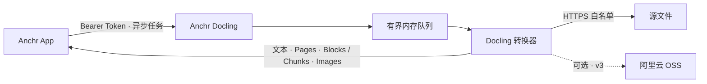

<div align="center">

# Anchr Docling

**Anchr 的文档解析 sidecar。**

[](https://www.python.org/)
[](https://github.com/docling-project/docling)
[](https://fastapi.tiangolo.com/)
[](./LICENSE)

</div>

---

Anchr Docling 为 [Anchr App](https://github.com/ryanmeowy/anchr-app) 提供文档解析能力。App 提交带签名的 HTTPS 下载地址，服务在受限队列中运行 Docling，并返回 Markdown、纯文本、结构化文档、Block 或 Chunk。需要时，服务也可以把文档内嵌图片上传到指定的阿里云 OSS 目录。

这个仓库不保存知识库、文档或入库任务。任务状态和幂等记录只存在于进程内存中；App 负责持久化 parse identity，并在 sidecar 重启后重新提交任务。

## 工作方式



- `POST /v1/jobs` 提交任务，`GET /v1/jobs/{jobId}` 查询结果，`DELETE /v1/jobs/{jobId}` 确认终态结果。
- 默认启动 1 个 worker，等待队列容量为 8。队列满时返回 `429`，并携带 `Retry-After: 5`。
- `requestId` 是幂等键。稳定输入相同的重复请求返回原任务；同一 ID 对应不同稳定输入时返回 `409`。
- 源文件只能从本地配置的 HTTPS 主机白名单下载。调用方不能通过请求修改白名单。
- 解析结果默认保留 10 分钟，最多保留 16 个终态任务。确认、过期或服务重启后，结果不再可查。

## 运行

### 前置要求

- Python `3.11+`
- 能够安装 Docling 与其模型依赖的运行环境
- 可访问 Docling 模型下载源，或已经准备好本地模型缓存
- 一个不少于 32 个字符的内部 Token
- 至少一个允许下载源文件的主机名

### 安装并启动

```bash
git clone https://github.com/ryanmeowy/anchr-docling.git
cd anchr-docling

python -m venv .venv
source .venv/bin/activate
pip install -e .

cp .env.example .env
# 修改 .env 中的 Token 和下载白名单。

uvicorn anchr_docling.main:app --host 127.0.0.1 --port 8091
```

服务启动时会校验 `ANCHR_DOCLING_API_TOKEN` 和 `ANCHR_DOCLING_ALLOWED_DOWNLOAD_HOSTS`。Anchr App 中的 `APP_DOCLING_API_TOKEN` 必须使用同一个 Token，`APP_DOCLING_BASE_URL` 指向当前服务地址。

默认会在启动阶段下载或检查布局、表格和公式相关模型，并初始化转换器。模型缓存尚未准备好时，第一次启动可能较慢。若部署环境不允许启动时访问模型缓存或网络，可以关闭预加载：

```bash
ANCHR_DOCLING_PRELOAD_MODELS=false
```

OCR 模型默认不预加载，只会在 `ocr: true` 或 OCR 回退时初始化。需要在启动阶段准备配置的 OCR 引擎时，设置：

```bash
ANCHR_DOCLING_PRELOAD_OCR_MODELS=true
```

### 设备

默认设备是 `cpu`。也可以设置为 `mps`、`cuda`、`xpu` 或 `auto`，最终可用性取决于本机 PyTorch、Docling 模型和所选解析能力：

```bash
ANCHR_DOCLING_DEVICE=cpu
```

当前依赖已将 `transformers` 约束在 `>=5.8.1,<5.9.0`，安装项目时会自动应用，不需要手工修改依赖版本。

## API

除 `/healthz` 外，所有 `/v1/*` 接口都需要 Bearer Token。Swagger、ReDoc 和 OpenAPI 默认关闭；本地调试可设置 `ANCHR_DOCLING_ENABLE_DOCS=true`。

### 健康检查

```bash
curl http://127.0.0.1:8091/healthz
```

```json
{
  "status": "ok",
  "running": 0,
  "queued": 0,
  "queueCapacity": 8
}
```

该接口只反映进程和队列状态，不验证模型、源文件主机或 OSS 的连通性。

### 提交任务

```bash
curl -X POST http://127.0.0.1:8091/v1/jobs \
  -H "Authorization: Bearer <internal-token>" \
  -H 'Content-Type: application/json' \
  -d '{
    "requestId": "task_1:item_1:1",
    "contractVersion": 2,
    "sourceRevision": "v1:0123456789abcdef0123456789abcdef0123456789abcdef0123456789abcdef",
    "sourceUrl": "https://anchr.oss-cn-shanghai.aliyuncs.com/document.pdf",
    "fileName": "document.pdf",
    "options": {
      "outputFormat": "chunks",
      "ocr": true,
      "ocrFallback": true,
      "useNativeChunker": true
    }
  }'
```

`sourceUrl` 的主机必须出现在 `ANCHR_DOCLING_ALLOWED_DOWNLOAD_HOSTS` 中。新任务返回 `202 Accepted`；幂等命中已有任务时返回 `200 OK`。

顶层字段：

| 字段 | 必填 | 说明 |
| --- | --- | --- |
| `requestId` | 是 | 解析 attempt 的幂等 ID，最长 200 个字符。App 使用 `taskId:itemId:parseAttempt`。 |
| `contractVersion` | App 新请求是 | 支持 `1`、`2`、`3`。当前普通解析使用 v2，内嵌图片上传使用 v3。 |
| `sourceRevision` | v2 / v3 是 | 稳定的源内容版本，最长 80 个字符；不能使用会刷新的签名 URL。 |
| `sourceUrl` | 是 | 源文件 HTTPS 地址。 |
| `fileName` | v2 / v3 是 | 含扩展名的文件名，用于选择解析路径。 |
| `options` | 否 | 解析和输出选项。 |
| `oss` | 图片上传时是 | 内嵌图片上传目标与加密 STS 凭据。 |

`contractVersion` 未传或为 v1 时，幂等指纹包含完整请求，主要用于兼容旧调用方。v2 和 v3 的指纹不包含会过期的 `sourceUrl` 与加密凭据，因此同一次 attempt 可以携带新的签名 URL 或 STS 凭据重试；`sourceRevision`、文件名、解析选项或稳定输出位置发生变化时，必须使用新的 `requestId`。

解析选项：

| 字段 | 默认值 | 说明 |
| --- | --- | --- |
| `outputFormat` | `markdown` | `markdown`、`html`、`text`、`json`、`blocks` 或 `chunks`。 |
| `ocr` | `false` | 直接启用 OCR；图片输入通常需要开启。 |
| `ocrFallback` | `false` | 非 OCR 结果被判定为乱码时，依次尝试配置的 OCR 引擎。 |
| `tableStructure` | `true` | 启用表格结构识别。 |
| `formulaEnrichment` | `false` | 启用 Docling 公式增强。会增加模型准备和解析时间。 |
| `validateTextQuality` | `true` | 检查明显乱码；非图片空结果会被判定为失败。 |
| `chunkMinTokens` | `400` | 自定义 Chunker 的目标下限；原生 Chunker 用于合并控制。 |
| `chunkMaxTokens` | `800` | 自定义 Chunker 按估算字符数控制上限；原生 Chunker 按估算 Token 切分。 |
| `useNativeChunker` | `false` | 使用 Docling `HybridChunker`；否则按 Markdown 结构切分。 |
| `includeEmbeddedImages` | `false` | 对 `markdown`、`blocks`、`chunks` 启用内嵌图片处理。 |

### 查询和确认结果

```bash
curl http://127.0.0.1:8091/v1/jobs/<jobId> \
  -H "Authorization: Bearer <internal-token>"
```

任务状态为 `queued`、`running`、`succeeded` 或 `failed`。成功结果位于 `result`，失败信息位于 `error`：

```json
{
  "jobId": "4c54b626-e367-4c92-a351-62d52f68948a",
  "requestId": "task_1:item_1:1",
  "status": "succeeded",
  "createdAt": "2026-07-10T10:00:00Z",
  "startedAt": "2026-07-10T10:00:01Z",
  "finishedAt": "2026-07-10T10:00:08Z",
  "result": {
    "requestId": "task_1:item_1:1",
    "parser": "docling",
    "format": "chunks",
    "fileType": "pdf",
    "text": "# 解析后的文档",
    "pages": [],
    "document": null,
    "blocks": null,
    "chunks": [],
    "images": null,
    "warnings": null
  },
  "error": null
}
```

读取终态后可发送 DELETE 释放内存记录：

```bash
curl -X DELETE http://127.0.0.1:8091/v1/jobs/<jobId> \
  -H "Authorization: Bearer <internal-token>"
```

终态任务、已确认任务、已过期任务和重启后丢失的任务都返回 `204 No Content`。删除仍在排队或运行的任务返回 `409`，该接口不是取消操作。

### 输入与输出

当前适配代码明确区分以下输入：

| 输入 | 支持的输出 | 说明 |
| --- | --- | --- |
| PDF | 全部格式 | 支持表格、OCR、公式增强和页级结果。 |
| PNG、JPEG、TIFF、BMP、GIF、WebP | 全部格式 | 空文本可作为成功结果返回；需要文本时应开启 OCR。 |
| Markdown、纯文本 | 仅 `chunks` | Markdown 使用 Docling 结构，纯文本按段落构造文档。 |

其他扩展名目前没有独立适配和测试保证，不应仅根据 Docling 上游的格式列表视为本服务已支持。

| 输出格式 | 主要结果 |
| --- | --- |
| `markdown` | `text` 和 `pages[].text` 为 Markdown。 |
| `html` | `text` 和页级文本为 HTML。 |
| `text` | 纯文本。 |
| `json` | `document` 为完整 Docling 结构，`text` 保留聚合文本。 |
| `blocks` | `blocks` 为应用侧 Block 列表，包含层级、页码、坐标和可选图片字段。 |
| `chunks` | `chunks` 包含 `text`、`textPlain`、`charCount`，可带 `pageRange`、`bboxes` 和 `headings`。 |

图片输入没有提取到文本时仍返回 `succeeded`，`text` 为空字符串；非图片输入为空时返回 `DOCLING_PARSE_ERROR`。启用文本质量校验后，明显乱码会失败；设置 `ocrFallback: true` 可在首次转换质量不合格时尝试 OCR。

## 内嵌图片上传

内嵌图片上传默认关闭。当前 App 只在 `includeEmbeddedImages=true` 时使用 contract v3，并发送 OSS 目标和 AES-GCM 加密的临时 STS 凭据。

Docling 侧需要配置共享 AES 密钥和允许上传的原子目标：

```bash
ANCHR_DOCLING_OSS_ENCRYPT_KEY=<32 字节原文或 Base64 密钥>
ANCHR_DOCLING_ALLOWED_UPLOAD_TARGETS='[
  {
    "endpoint": "oss-cn-hangzhou.aliyuncs.com",
    "bucket": "my-bucket",
    "prefix": "embedded"
  }
]'
```

每条规则绑定完整的 `endpoint`、`bucket` 和 `prefix`。字段不支持通配符；prefix 只匹配自身或以 `/` 分隔的子目录。空白名单允许服务启动，但所有图片上传都会被拒绝，文本解析仍可通过 `warnings` 降级完成。

v3 请求中的 `oss` 结构：

```json
{
  "endpoint": "oss-cn-hangzhou.aliyuncs.com",
  "bucket": "my-bucket",
  "basePath": "embedded/ingestion/task-1/item-1/parse/1/images",
  "objectKeyLayout": "ATTEMPT_PREFIX_V1",
  "encryptedCredentials": {
    "version": 1,
    "keyId": "app-security-v1",
    "nonce": "<base64>",
    "ciphertext": "<base64>",
    "tag": "<base64>",
    "expiration": "2026-07-28T12:00:00Z"
  }
}
```

`ATTEMPT_PREFIX_V1` 要求非空 `basePath`，图片对象名为 `{basePath}/{sanitizedBlockId}.png`。同一 attempt 重试时，相同 Block 会得到相同对象 Key。`images[].imageObjectKey` 是持久化身份，`url` 只用于返回内容渲染。

## 配置

Pydantic Settings 会自动读取仓库根目录的 `.env`。以下是主要配置及代码默认值：

| 环境变量 | 默认值 | 用途 |
| --- | --- | --- |
| `ANCHR_DOCLING_HOST` | `127.0.0.1` | 服务监听地址；使用命令行启动时仍以 Uvicorn 参数为准。 |
| `ANCHR_DOCLING_PORT` | `8091` | 服务端口；使用命令行启动时仍以 Uvicorn 参数为准。 |
| `ANCHR_DOCLING_API_TOKEN` | 无有效默认值 | `/v1/*` 的内部 Bearer Token，至少 32 个字符。 |
| `ANCHR_DOCLING_ALLOWED_DOWNLOAD_HOSTS` | 空 | 逗号分隔的精确下载主机名；启动时不能为空。 |
| `ANCHR_DOCLING_WORKERS` | `1` | 解析 worker 数量。 |
| `ANCHR_DOCLING_QUEUE_CAPACITY` | `8` | 等待队列容量，不含正在运行的任务。 |
| `ANCHR_DOCLING_QUEUE_WAIT_TIMEOUT_SECONDS` | `1800` | 任务允许排队的最长时间。 |
| `ANCHR_DOCLING_RESULT_TTL_SECONDS` | `600` | 终态结果保留时间。 |
| `ANCHR_DOCLING_MAX_RETAINED_RESULTS` | `16` | 内存中最多保留的终态结果数。 |
| `ANCHR_DOCLING_MAX_DOWNLOAD_MB` | `100` | 单次源文件或 Markdown 图片下载上限。 |
| `ANCHR_DOCLING_MAX_DOWNLOAD_REDIRECTS` | `3` | 下载重定向上限。 |
| `ANCHR_DOCLING_MAX_IMAGE_MEGAPIXELS` | `80` | 图片解码尺寸上限。 |
| `ANCHR_DOCLING_DEVICE` | `cpu` | Docling 加速设备。 |
| `ANCHR_DOCLING_OCR_ENGINES` | `ocrmac,rapidocr` | OCR 与回退尝试顺序。非 macOS 环境应按实际安装的引擎调整。 |
| `ANCHR_DOCLING_OCR_LANG` | `chinese` | OCR 语言；各引擎会映射为对应语言代码。 |
| `ANCHR_DOCLING_FORCE_FULL_PAGE_OCR` | `true` | OCR 时启用全页识别。 |
| `ANCHR_DOCLING_PRELOAD_MODELS` | `true` | 启动时准备基础模型并初始化转换器。 |
| `ANCHR_DOCLING_PRELOAD_OCR_MODELS` | `false` | 启动时同时初始化配置的 OCR 引擎。 |
| `ANCHR_DOCLING_ALLOWED_UPLOAD_TARGETS` | `[]` | 允许的 OSS endpoint、bucket、prefix 组合。 |
| `ANCHR_DOCLING_OSS_ENCRYPT_KEY` | 空 | 解密 v3 STS 凭据的 AES 密钥。 |
| `ANCHR_DOCLING_ENABLE_DOCS` | `false` | 是否开放 `/docs`、`/redoc` 和 `/openapi.json`。 |

下载地址必须使用 HTTPS 默认端口，不能包含用户信息。初始 URL 和每次重定向都会重新校验主机白名单。队列可以限制并发和等待数量，但当前实现不会强制终止已经进入解析阶段的单个任务，也没有把解析任务隔离到独立子进程。

## 开发

```bash
python -m venv .venv
source .venv/bin/activate
pip install -e '.[dev]'

ruff check .
pytest -q
```

`scripts/verify_bbox.py` 和 `scripts/verify_pdf_bbox.py` 用于检查 Chunk/Block 的页码与坐标输出，需要本地准备相应样本。

## License

本项目基于 [MIT License](./LICENSE) 开源。
